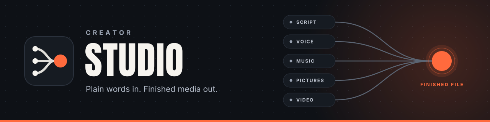
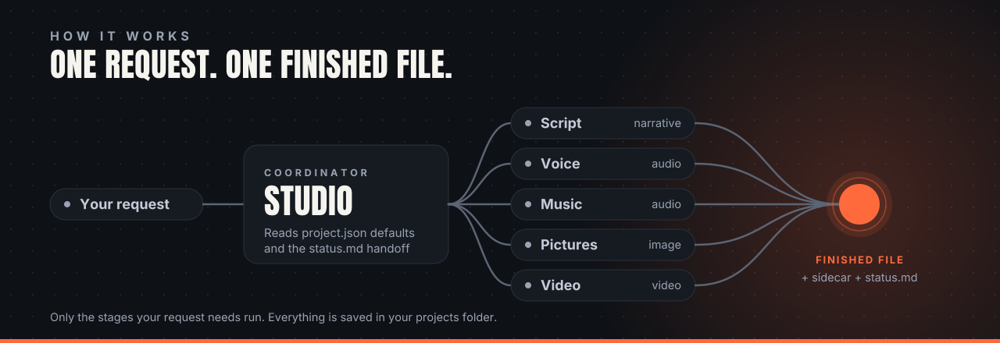

<div align="center">

<h1></h1>

**Ask for a finished narration, soundtrack, image set or video in plain words. Skills coordinate the voice, music, pictures and edit, and keep every choice you make.**

[](LICENSE)
[](https://docs.claude.com/en/docs/claude-code/plugins)
[](#how-it-works)

</div>

---

Creator Studio is a [Claude Code plugin marketplace](https://docs.claude.com/en/docs/claude-code/plugins) with five plugins (`studio-core`, `narrative`, `audio`, `image`, `video`). They hold instructions only: every stage is a `SKILL.md` the agent follows, using your own accounts and the tools on your computer. There is no server, no app and nothing of yours stored in this repo.

## What you can make

| | |
|---|---|
| **Scripts** | Narration for videos, explainers and stories (hook, pacing plan, claims to verify) and two-host podcast scripts. Or a review of your own script, wording untouched. |
| **Voice** | A directed read through ElevenLabs or a chosen OpenRouter TTS model: emotion, pace and emphasis, with a consent and AI-disclosure check. |
| **Music and effects** | Briefs, tracks and sound effects (ElevenLabs, or Suno in your own account) with licence checks. |
| **Audio finishing** | Joins, hand-placed pauses and pacing, music under the voice with ducking and fades, tone treatments, and a measured loudness master (for example -14 LUFS for YouTube). |
| **Pictures** | Character-consistent stills, outfits, composites and edits with Higgsfield, plus a checklist-based quality pass; OpenRouter image models are also selectable. |
| **Video** | OpenRouter video (frame support checked live), or Higgsfield image-to-video, start/end-frame and motion-transfer clips; assembly with FFmpeg or FilmCraft; burned-in captions; Shorts cut from long video; edit plans for CapCut, Descript and OpusClip. |

## Requirements

- **[Claude Code](https://docs.claude.com/en/docs/claude-code)** (macOS, Linux or Windows). That is the only hard requirement: scripting and planning work with nothing else.
- **Accounts, all optional.** Connect only the ones you want; a project can mix them per modality.

  | Account | Unlocks | How it is reached |
  |---|---|---|
  | [ElevenLabs](https://elevenlabs.io) | voice, music, sound effects, voice library | Claude connector or MCP server ([Connecting accounts](#connecting-accounts)), or the website in your browser |
  | [Higgsfield](https://higgsfield.ai) | character-consistent stills, image-to-video, motion transfer | MCP server or connector, the `higgsfield` CLI, or the website |
  | [OpenRouter](https://openrouter.ai) | text-to-speech, transcription, images, video | `OPENROUTER_API_KEY` in your shell environment; curl |
  | [Suno](https://suno.com) | music | the website, in your own signed-in browser |
  | CapCut, Descript, OpusClip | edit, transcript-edit and clipping plans | your own apps and accounts |

- **Local tools, installed by the agent when a stage needs them** (it asks first): FFmpeg, whisper.cpp with a model file and Rubber Band (narration timing), curl, jq and Python 3 (OpenRouter), the Higgsfield prompting skill (Higgsfield routes), and FilmCraft (optional editor). See [Dependencies](#dependencies).

## Quick start

**1. Install the plugins** in Claude Code:

```text
/plugin marketplace add sebby26-cyber/creator-studio
/plugin install studio-core@creator-studio
/plugin install narrative@creator-studio
/plugin install audio@creator-studio
/plugin install image@creator-studio
/plugin install video@creator-studio
```

`studio-core` is always needed: it is the coordinator and holds the shared references. The other four cover their stages; install all five for the full pipeline.

**2. Start a new session and say:**

> Set up Creator Studio.

That is the whole setup. The agent will:

1. explain what it can do and show example requests,
2. ask **where your projects should live** (suggesting `~/CreatorStudio`) and remember it,
3. **check for what it needs and install what is missing**: FFmpeg, the Higgsfield prompting skill, FilmCraft if you want it. It tells you what it will run first and asks before system-level installs. It also tells you which optional accounts to connect (ElevenLabs, Higgsfield), or how to export `OPENROUTER_API_KEY` in your shell profile/environment for OpenRouter (never in the repo, project file or chat); sign-ins are always yours,
4. offer to **create your first project**, optionally saving voice, transcription, image and video defaults picked from live OpenRouter listings; "decide each time" leaves them unset. Mix providers per modality: for example ElevenLabs music/effects, OpenRouter TTS/images and Higgsfield video.

**3. Ask for something:**

> Use project my-channel. Write a three-minute explainer about how tides work, narrate it with the Narrator voice, add a calm music bed and master it for YouTube.

More examples:

> Make a still of my character in a rain-soaked street, then animate it for five seconds.
>
> Narrative pass on my script, keep my wording.
>
> Turn this podcast into five Shorts with captions.

## Connecting accounts

Sign-ins are always yours; the agent never types passwords, keys or payment details.

- **ElevenLabs.** In Claude, open **Settings > Connectors**, add **ElevenLabs** and sign in. Claude Code uses the same connectors when it is signed in with that claude.ai account; they show up as `mcp__claude_ai_ElevenLabs__*` tools. Or add ElevenLabs' MCP server to Claude Code yourself:
  ```text
  claude mcp add --transport http elevenlabs https://api.elevenlabs.io/v1/mcp
  ```
  then run `/mcp` and sign in. The skills use the connector's `creative_*` tools (the model file [`elevenlabs.json`](plugins/studio-core/skills/studio/references/models/elevenlabs.json) names them as `mcp__claude_ai_ElevenLabs__creative_*`; on the server you add yourself they carry its own prefix). Other ElevenLabs MCP servers expose different tools; with those, or with no connector, use the `web` route (your signed-in browser).
- **Higgsfield.** In Claude Code:
  ```text
  claude mcp add --transport http higgsfield https://mcp.higgsfield.ai/mcp
  ```
  then run `/mcp` and sign in. The skills expect the `mcp__higgsfield__*` tool names this gives. Higgsfield can also be reached through its CLI (`npm install -g @higgsfield/cli`, the agent can install it) or the website. Higgsfield routes also need the Higgsfield prompting skill, which the agent installs.
- **OpenRouter.** Export the key in your shell profile and restart the shell and Claude Code:
  ```sh
  export OPENROUTER_API_KEY=...   # in ~/.zshrc, ~/.bashrc or your environment, never in the repo, a project file or the chat
  ```
  The agent only checks that it is set (`test -n "$OPENROUTER_API_KEY"`) and never reads, prints or stores it. Listing models needs no key.
- **Suno, CapCut, Descript, OpusClip.** Nothing to connect: sign in to them in your own browser or app. The agent plans the work and says which steps are yours.

## What it feels like

| You say | What happens |
|---|---|
| "What can you do?" | A friendly tour and example requests. |
| "Narrative pass on my script, keep my wording." | Your draft is kept verbatim, split into beats, with claims flagged for verification. |
| "Use Kling for the clips in this project from now on." | `models.video.default` is saved in the project; later runs follow it. |
| "Use Kling for this episode only." | Pinned in that production's status note, not in the project. |
| "Approve scenes two and five; redo scene three." | Only scene three and the work that depends on it is refreshed. |
| "Resume episode 4." | The production's status note is read and work continues from the recorded next action. |
| "Turn this podcast into five Shorts with captions." | A clipping plan and timecoded cut list for review, then the cuts. |

## How it works



There is no program to install or run. Every stage is a `SKILL.md` that states what it **takes**, what it **makes**, which **tool** it uses and where the result is **saved**. The agent follows those instructions with tools you already have (your connectors, FFmpeg, a browser), and you can read and edit every one.

### One request, step by step

1. **You ask in plain words.** Name a project if you have one: "Use project my-channel, then make…".
2. **`studio` gets its bearings.** It finds your projects folder, loads that project's `project.json` defaults and, when you are resuming, the production's `status.md`. A project that does not exist yet is created from the template.
3. **Only the stages you need run.** A revision can start at the stage it affects. Pictures can be made alongside the audio, but final shots and captions use the real narration timings, not the estimated script length.
4. **Everything is saved as it goes.** Provider links expire, so each output is downloaded into the production folder straight away, hashed, and recorded with the inputs it came from.
5. **A run ends with three things:** the finished file, a `<file>.json` sidecar, and an updated `status.md` (file location, review state, open defects, next action, actual costs). Publishing is separate and optional.

### The stages

| Stage | Plugin | What comes out |
|---|---|---|
| Script | `narrative` | A narration or two-host script with beats and claims flagged for checking, or your own script reviewed with its wording untouched. |
| Voice | `audio` | A directed ElevenLabs or selected OpenRouter TTS read (emotion, pace, emphasis where supported), after a consent and AI-disclosure check. |
| Music and effects | `audio` | Briefs, then rendered music and effects tied to script cues, with licence checks. No effects is a valid answer. |
| Pictures | `image` | Character-consistent stills and a PASS / CONDITIONAL PASS / FAIL quality report. |
| Mix and master | `audio` | A narration timing table, music ducked under the voice, and a loudness-measured master. |
| Video | `video` | Clips, assembly over the master audio, burned-in captions, Shorts cuts, and edit plans for CapCut, Descript and OpusClip. |

Every skill in each plugin is listed under [Plugins and skills](#plugins-and-skills).

### Providers and routes

Providers are optional; set up only the ones you want. A project can mix them per modality.

| Provider | Modalities | How reached | What you set up |
|---|---|---|---|
| OpenRouter | TTS, transcription, images, video | `openrouter` (curl) | Export `OPENROUTER_API_KEY` in your shell profile/environment; choose models from public live listings |
| ElevenLabs direct | Voice, music, effects, voice library | `mcp` connector or `web` | Connect and sign in to your account |
| Higgsfield | Images, video, motion transfer | `mcp`, `cli` or `web` | Connect/sign in; install its prompting skill for these routes |
| Suno | Music | `web` | Your signed-in account |

OpenRouter verification: docs dated 2026-10-17 and public `/models` lists; **[observed]:** one maintainer-reported ElevenLabs v4 TTS A/B found no observable effect from `instructions` (see the [tagging reference](plugins/studio-core/skills/studio/references/elevenlabs-tagging.md)); **[unverified]:** other generation calls, ElevenLabs voice portability, `scribe-v2` options, video `frame_images` object shape.

ElevenLabs v3/v4 share bracket audio tag syntax on direct and OpenRouter routes; delivery is model-specific ([maintainer-observed]). v4 is recommended for new work; the model always comes from the resolved project `voices[].model`, never a code default. Selected v3 stays valid. For v4/v4 Turbo omit speed; for ElevenLabs via OpenRouter omit instructions and put direction in tagged input. [Tagging and route reference](plugins/studio-core/skills/studio/references/elevenlabs-tagging.md).

### Working rules

- **Your choices are binding.** Name a model, tool, voice or seed and it is kept, or the agent explains which specific capability is unsupported. Nothing is silently swapped.
- **Paid steps are explicit.** Before any paid generation the agent checks the real price where the provider allows it, tells you, and waits for your OK. An unknown price is never treated as free, and a project can set a spend cap.
- **You approve, not the agent.** Generated is not approved. Script gates and listening tests are yours, and an approval is never recorded on your behalf.
- **Resumable.** Each production keeps a `status.md` handoff, so "resume episode 4" picks up exactly where it stopped.
- **Revise only what changed.** Approve some drafts, redo one scene, and only the affected work is refreshed. Replaced files are kept, not overwritten.
- **Your files stay yours.** Media, project files and secrets live in your projects folder and connectors, never in this repo.

## Projects and saved defaults

A project is a folder in your own **projects folder**, outside this repo. The agent finds that folder from, in order: a path you give in the request, `$CREATOR_STUDIO_VAULT`, then `vault_root` in `~/.creator-studio/config.json`. On a first run it asks where projects should live (suggesting `~/CreatorStudio`) and, with your OK, saves the answer to that config file. `$CREATOR_STUDIO_PROJECT` can name a default project. Its `project.json` stores the defaults every run follows, so you don't repeat yourself:

```json
{
  "slug": "my-channel",
  "kind": "youtube",
  "models": {
    "image": { "default": "nano_banana_2", "allowed": [], "locked": false },
    "video": { "default": "kling3_0" }
  },
  "defaults": { "aspect": "16:9", "captions": true, "seed": null },
  "tools": { "prefer": ["filmcraft"], "avoid": ["capcut"] },
  "spend": { "limit_credits": 200, "ask_above_credits": 20 },
  "audio": { "loudness": { "integrated_lufs": -14, "true_peak_dbtp": -1 } }
}
```

- **Every new project is seeded** from a template (`plugins/studio-core/skills/studio/references/templates/project.json`). Put your personal defaults in `<your projects folder>/project-defaults.json` and they seed every new project too. No existing config or defaults file is needed; the [OpenRouter example seed](plugins/studio-core/skills/studio/references/templates/project-defaults.openrouter.example.json) shows the shape, with fictional ids to replace after live discovery.
- **Say it in words to save one:** "make Kling the default video model for this project". "Just for this episode" is not saved.
- **A default is a default, not a trap.** Your request always wins; a `locked` model is a project rule the agent will explain rather than override; a default that can't do the job (for example a Soul model asked to wear an outfit) is flagged, never swapped silently.
- **Mix routes per modality.** Choose models in `models.<modality>.default`, then reach each model’s provider via `routes.<provider>.default` or a per-model key. For OpenRouter set `routes.openrouter.default` to `"openrouter"` and export `OPENROUTER_API_KEY` in your shell profile/environment, never in the repo, project file or chat; other modalities can keep their direct providers.
- **A missing key means no default.** OpenRouter models use the same `models.*.default` / `allowed` / `locked` choices and production overrides. USD costs use an explicit `spend.credits_per_usd` conversion for credit caps; there is no default rate.
- **New keys are easy to add**, and older project files keep working. Every key is documented in [`project-file.md`](plugins/studio-core/skills/studio/references/project-file.md).

```text
<your projects folder>/
├── project-defaults.json          optional: seeds every new project
└── projects/my-channel/
    ├── project.json               saved settings and defaults
    ├── workflow.md                optional: your own rules and review checkpoints
    └── productions/<production>/
        ├── status.md              resumable handoff
        └── …                      the files made, each with a sidecar
```

## Dependencies

The agent checks for these before the stage that needs them and installs what it can. Full commands and rules: [`dependencies.md`](plugins/studio-core/skills/studio/references/dependencies.md).

| Dependency | For | Who sets it up |
|---|---|---|
| [FFmpeg](https://ffmpeg.org/) (libass for caption burn-in) | mixing, mastering, assembly, captions, measurement | The agent installs it, with your OK |
| [whisper.cpp](https://github.com/ggml-org/whisper.cpp) (`whisper-cli`) and a model file | word timing for pace and pause, transcript checks, QC | The agent installs it and downloads a model (for example `ggml-base.en.bin`), with your OK |
| [Rubber Band](https://breakfastquay.com/rubberband/) 3 or newer | slowing narration that runs too fast, rate tapers | The agent installs it, with your OK |
| `mlx-whisper` (optional, Apple Silicon only) | faster local speech-to-text | Optional; `whisper-cli` does the same job everywhere |
| curl, jq, Python 3 | OpenRouter requests and JSON handling | The agent installs what is missing, with your OK |
| [Higgsfield prompting skill](https://github.com/OSideMedia/higgsfield-ai-prompt-skill) (pinned `v3.40.0`) | image and video prompts | The agent clones it into `~/.claude/skills/higgsfield` |
| [FilmCraft](https://github.com/storytold/filmcraft) (optional, pinned `v0.4.0`) | headless finishing and short cuts | The agent installs it, with your OK |
| [ElevenLabs](https://elevenlabs.io) connector or MCP server | voice, music, effects | You connect and sign in ([how](#connecting-accounts)) |
| [Higgsfield](https://higgsfield.ai) MCP server or CLI | images, image-to-video | You connect and sign in ([how](#connecting-accounts)); the agent can install the CLI |
| [OpenRouter](https://openrouter.ai) (optional) | speech, transcription, images, video | You export `OPENROUTER_API_KEY` in your shell environment; the agent checks only that it is set |
| Suno, CapCut, Descript, OpusClip (optional) | those tools' stages | Your own accounts and apps |

## Privacy

- **Nothing leaves your computer except calls to the providers you connect** (ElevenLabs, Higgsfield, OpenRouter, and the sites you use in your browser), and only for the steps you ask for. Creator Studio has no server and collects nothing.
- **Keys are never stored in this repo or in a project.** Provider credentials stay in the connectors, CLIs and browsers you already use. The OpenRouter key lives in your shell environment; the agent never asks for, prints or stores it.
- **Your media and project files stay in your projects folder.** Generated files are downloaded there as they arrive; nothing is written into the plugin folders.

## Troubleshooting

- **The skills do not show up.** Check `/plugin` lists the five plugins as installed, then start a new Claude Code session. A skill installed mid-session (such as the Higgsfield prompting skill) may only load in a new session.
- **The agent says a connector is missing.** Run `/mcp` to see which servers are connected and signed in; see [Connecting accounts](#connecting-accounts). Without one, the `web` route uses your signed-in browser.
- **`OPENROUTER_API_KEY` is not set.** Export it in your shell profile, open a new terminal and restart Claude Code from it.
- **`hf` runs the wrong program.** The HuggingFace CLI can shadow Higgsfield's `hf` alias; the skills always type the full `higgsfield` command.
- **A local tool is missing or a check fails.** Ask "check my Creator Studio setup": the agent re-runs the checks in [`dependencies.md`](plugins/studio-core/skills/studio/references/dependencies.md) and says what to install.

## Plugins and skills

| Plugin | Skill | Purpose |
|---|---|---|
| `studio-core` | `studio` | Coordinator: first-run setup, projects and defaults, stage selection, kept choices, `status.md` handoffs. |
| | `asset-persist` | Download an expiring provider URL into the production, hash it and record it. |
| `narrative` | `narration-and-story-scripting` | Narration scripts for any medium; reviews your own script without rewriting it. |
| | `two-host-podcast-director` | Turns notes, transcripts or chats into a two-host podcast script with audio direction. |
| `audio` | `emotional-director` | A model-agnostic emotional delivery layer (emotion, intensity, energy, pace, arc); words untouched. |
| | `elevenlabs-voice-director` | Directs an ElevenLabs read: tags, punctuation and settings for the pinned model. |
| | `elevenlabs-voice-director-sleep` | Sleep-register variant: hold tags, no pause tags, long rests as room-tone assembly silence, render options always sent (measured on one v4 voice; verify on yours). |
| | `speech-render` | Renders narration or dialogue via ElevenLabs (connector or web) or OpenRouter (curl) with chunk mapping. |
| | `sound-render` | Renders music cues and effects with ElevenLabs Music and Sound Effects. |
| | `ai-music-and-sound` | Music and sound-design briefs with licence, Content ID and disclosure checks. |
| | `suno` | Arranges a Suno music brief and generates it in your signed-in app. |
| | `ai-voiceover` | Rewrites text for the ear and gates the voice on consent and AI disclosure. |
| | `audio-post-mix` | Assembles narration with measured timing; places and mixes music and effects (FFmpeg recipes included). |
| | `pace-and-pause` | Opt-in timing pass on the joined narration: hand-placed pauses and rests, and slowing only sentences that run too fast (whisper.cpp, Rubber Band). |
| | `audio-treatment` | Applies a named EQ/level treatment with FFmpeg and measures it. |
| | `audio-master` | Two-pass EBU R128 loudness master with independent measurement. |
| `image` | `image-generate` | OpenRouter stills and reference edits, or Higgsfield Soul id, Elements, composites, edits and outfit assets. |
| | `image-verify` | Applies a project's image QC checklist: PASS / CONDITIONAL PASS / FAIL. |
| `video` | `visual-director` | Turns a locked narration into a budgeted shot-by-shot visual plan (`visual-plan.md` + `timeline.json`): coverage, cut rhythm, cheapest treatment per shot, continuity against reveals, music/SFX spotting, briefs for a separate prompt-writer, rule checks. Plans only. |
| | `video-from-image` | OpenRouter video (verify frame schema), or Higgsfield image-to-video, start/end frame and motion transfer. |
| | `clip-assemble` | FFmpeg still loops, slideshows and clip assembly over finished audio, with captions (recipes included). |
| | `filmcraft` | Headless finishing and short cuts in FilmCraft over its CLI or MCP server. |
| | `episode-conform` | Spec for conforming an edit plan into a finished episode in an NLE from timing tables: data contracts, one-pass rebuilds, level solver, voice-edit hygiene, QC checklist and review loop. Spec only; the project builds its own toolkit. |
| | `capcut`, `descript`, `opus-clip`, `captions-and-clipping` | Edit, transcript-edit and clipping plans for those tools. |

## Repository layout

```text
creator-studio/
├── .claude-plugin/marketplace.json     marketplace manifest (five plugins)
├── assets/brand/                       banner, mark, social preview, brand sheet, how-it-works diagram (see BRAND.md)
└── plugins/
    ├── studio-core/                    coordinator, asset-persist, and its references:
    │   └── skills/studio/references/     capabilities, dependencies, project-file, production-handoff,
    │                                     output-sidecar, templates/project.json, models/*.json
    ├── narrative/                      scripting
    ├── audio/                          voice, music, effects, mix, master
    ├── image/                          stills and QC
    └── video/                          clips, assembly, finishing, edit planning
```

`references/models/*.json` are dated snapshots of model ids, capabilities and estimated credits (OpenRouter: USD pricing and explicit credit conversion). Discover OpenRouter models live via public `GET /api/v1/models` (no key needed for listing; filter `output_modalities=speech|transcription|image|video`, one per query), plus `/images/models` and `/videos/models`; its snapshot is only a seed/fallback when offline or the list is unreachable. ElevenLabs music, SFX and voice-library access stay on the direct ElevenLabs route. They are lookups, not proof of current prices: the agent confirms with the live connector or a cost check before spending.

## Contributing

Contributions are welcome. See [CONTRIBUTING.md](CONTRIBUTING.md). Visuals follow [BRAND.md](BRAND.md).

## License

Copyright (C) 2026 sebby26-cyber

Creator Studio is free software: you can redistribute it and/or modify it under the terms of the GNU General Public
License as published by the Free Software Foundation, either version 3 of the License, or (at your option) any later
version. See [LICENSE](LICENSE).

Some skills are adapted from third-party work under their own licenses, kept alongside them:

- `capcut`, `descript`, `opus-clip`, `captions-and-clipping`, `ai-music-and-sound`, `suno`, `ai-voiceover`: adapted from
  the [`social-media-skills`](https://github.com/social-media-skills/skills) plugin v1.0.1 by Frank Heijdenrijk, MIT
  License (see each skill's `LICENSE`). Other skills from that plugin that these mention are not included; they are
  optional and used only if you install that plugin yourself.
- `filmcraft`: a wrapper for [FilmCraft](https://github.com/storytold/filmcraft), MIT OR Apache-2.0 (licenses and
  `NOTICE` in the skill folder).
- The Higgsfield prompting skill, installed on demand from
  [OSideMedia/higgsfield-ai-prompt-skill](https://github.com/OSideMedia/higgsfield-ai-prompt-skill) under its own license.

## Acknowledgements

- [Anthropic Claude Code](https://docs.claude.com/en/docs/claude-code) for the plugin and skill system.
- Frank Heijdenrijk's [`social-media-skills`](https://github.com/social-media-skills/skills) for the craft frameworks behind several video and audio skills.
- The [FilmCraft](https://github.com/storytold/filmcraft) team for an open-source, scriptable editor.
- [OSideMedia](https://github.com/OSideMedia/higgsfield-ai-prompt-skill) for the Higgsfield prompting skill.
- [FFmpeg](https://ffmpeg.org/), [ElevenLabs](https://elevenlabs.io), [Higgsfield](https://higgsfield.ai) and
  [Suno](https://suno.com).
